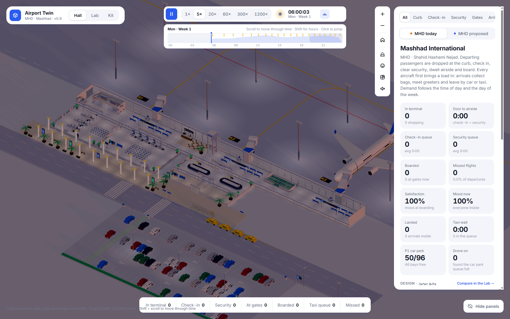
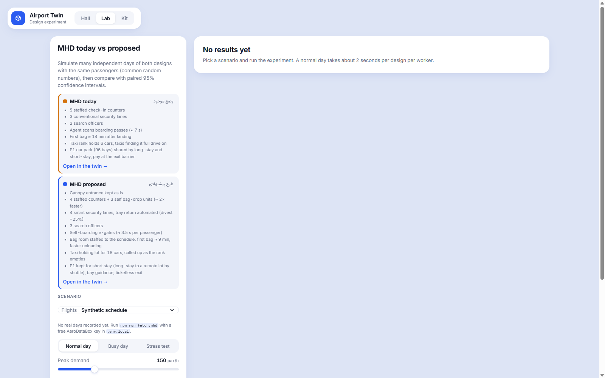
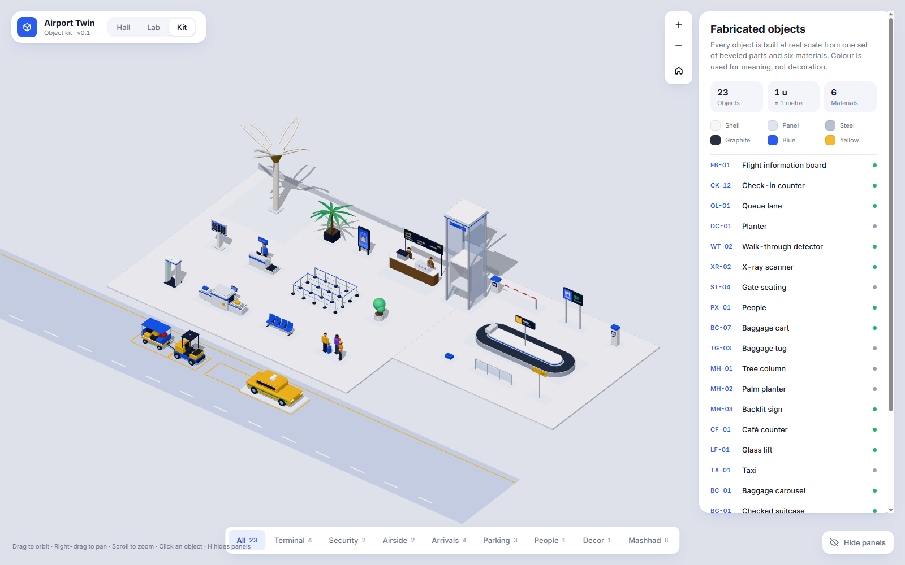

<div align="center">

# ✈️ Mashhad Airport Twin

**A Sims-style 3D digital twin of Mashhad International Airport (MHD), driven by one seeded discrete-event simulation.**

Every passenger, bag, taxi and parked car is simulated. The same seed replays the same week, every time.

[](https://github.com/a0x0h/airport-twin/actions/workflows/ci.yml)
[](https://a0x0h.github.io/airport-twin/)
[](LICENSE)


[](CONTRIBUTING.md)

[**Live demo**](https://a0x0h.github.io/airport-twin/) · [Features](#-features) · [Quick start](#-quick-start) · [Real data](#-replay-real-days-at-mhd) · [Contributing](CONTRIBUTING.md)



</div>

## ✨ Features

| | |
| --- | --- |
| 🛫 **Departures** | Curb drop-off under the MHD canopy, check-in, security lanes with blocking and a shared officer pool. Duty-free, café and prayer-room dwell, then gate holdrooms, boarding and missed flights. |
| 🛬 **Arrivals** | Every aircraft unloads before it turns round. Passengers wait at the carousel for their own bag, clear customs, then meet a greeter, take a pick-up car or join the taxi rank (a double-ended queue). |
| 🅿️ **Parking** | P1, a 96-bay car park used by greeters, drop-off drivers and long-stay travellers. When it is full, the barrier shuts, cars queue on the road and some drivers give up. |
| 🕒 **Time** | Day and week clock with time-of-day lighting. Demand follows hourly and weekday profiles. The timeline scrubs back and forth through the run. |
| 🧪 **Lab** | Paired replications with common random numbers, run in Web Workers, with 95% confidence intervals for each metric. |
| 📡 **Real data** | Replay recorded days of AeroDataBox flights and METAR weather, and compare crowding with Google Maps *Popular times*. |

## 🏗️ Two designs, one engine

**MHD today** and an **MHD proposed** design run on the same simulation, so the comparison is fair:

- Self bag-drop and smart security lanes
- Self-boarding e-gates
- A faster first bag
- A taxi holding lot
- P1 kept for short stay, with bay guidance and ticketless exit

<table>
  <tr>
    <td width="50%"></td>
    <td width="50%"></td>
  </tr>
  <tr>
    <td align="center"><b>Lab</b>: design experiments</td>
    <td align="center"><b>Kit</b>: the 3D object catalog</td>
  </tr>
</table>

## 🚀 Quick start

```bash
git clone https://github.com/a0x0h/airport-twin.git
cd airport-twin
npm ci
npm run dev
```

Open <http://localhost:5180>. Requires **Node.js 20+** and a browser with WebGL.

| Script | What it does |
| --- | --- |
| `npm run dev` | Start the dev server with hot reload |
| `npm run build` | Type-check and build to `dist/` |
| `npm run preview` | Serve the production build |
| `npm run typecheck` | Run the TypeScript checker only |
| `npm run fetch:mhd` | Record real days at MHD (see below) |

### Routes

| Route | What |
| --- | --- |
| `#/hall` | The live twin. Zone tabs: All, Curb, Check-in, Security, Gates, Arrivals, Parking, Airside. |
| `#/lab` | Design experiments |
| `#/kit` | Catalog of the hand-built 3D objects |

## 📡 Replay real days at MHD

1. Get a free key: subscribe to the **Basic** plan of [AeroDataBox on RapidAPI](https://rapidapi.com/aedbx-aedbx/api/aerodatabox).
2. Copy `.env.example` to `.env.local` and set `RAPIDAPI_KEY` (the file is git-ignored).
3. Record data:
   ```bash
   npm run fetch:mhd                          # yesterday (Tehran time)
   npm run fetch:mhd -- 2026-10-21            # one day
   npm run fetch:mhd -- 2026-10-15 2026-10-21 # a range
   ```
   Files land in `public/data/mhd/`. METAR weather from [aviationweather.gov](https://aviationweather.gov) is included and needs no key.
4. In the twin, **Terminal → Data → Flights** switches between the synthetic schedule and recorded days. The Lab uses the same setting.

Google Maps *Popular times* has no API. Copy the bar heights (0–100) by hand into `public/data/mhd/popular-times.csv`. The **Crowding vs Google** chart compares that shape with the simulation's.

## 🧱 Architecture

```
src/
├── sim/      Discrete-event engine: hall, airside, arrivals, landside, parking, experiments (+ Web Worker)
├── scene/    three.js scenes via @react-three/fiber: Hall, Diorama, daylight
├── kit/      Hand-built 3D objects, materials and primitives
├── ui/       Overlay, timeline, Lab, data-source panels
├── data/     Synthetic flight schedule and real-day loader
└── design/   Design tokens (white / blue / yellow palette)
```

**Stack:** [Vite](https://vite.dev) · [React 19](https://react.dev) · [TypeScript](https://www.typescriptlang.org) · [three.js](https://threejs.org) · [@react-three/fiber](https://r3f.docs.pmnd.rs) and [drei](https://drei.docs.pmnd.rs) · [zustand](https://zustand.docs.pmnd.rs)

## 🗺️ Roadmap

- [x] Object kit, check-in, security, gates and boarding
- [x] Design comparison and the Lab
- [x] Arrivals, baggage claim and the taxi rank
- [x] P1 car park simulation
- [x] Real-day replay (AeroDataBox and METAR)
- [ ] Calibrate service times against recorded days
- [ ] International terminal and transfer flows
- [ ] Export Lab results to CSV

See [CHANGELOG.md](CHANGELOG.md) for release history.

## 🤝 Contributing

Contributions are welcome. Read the [contributing guide](CONTRIBUTING.md) and the [code of conduct](CODE_OF_CONDUCT.md), then open an issue or a pull request.

## 📄 License

[MIT](LICENSE) © Abolfazl Hosseini

<div align="center">
<sub>Built for a simulation course · If this project helped you, consider giving it a ⭐</sub>
</div>
